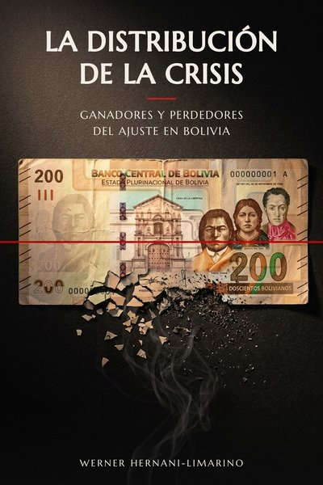
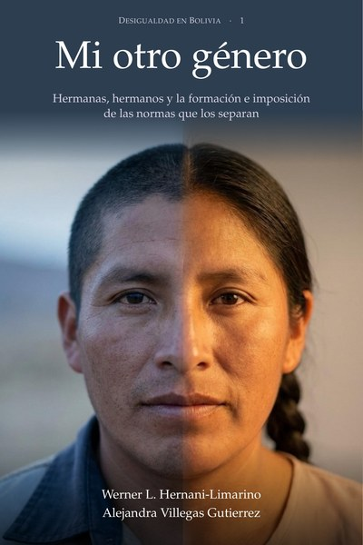
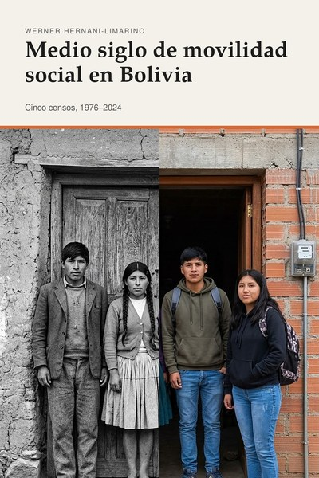
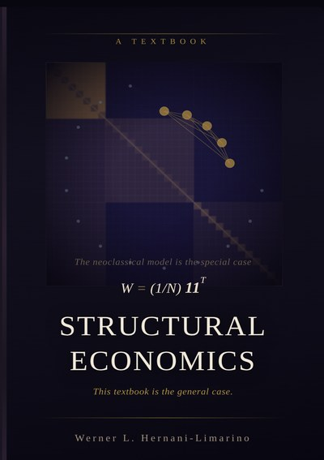
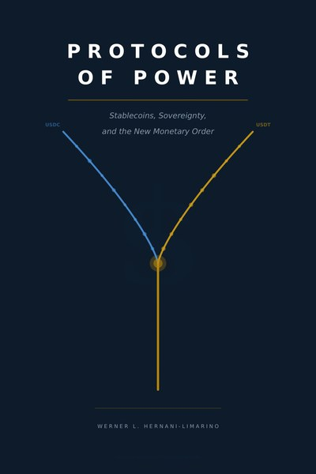
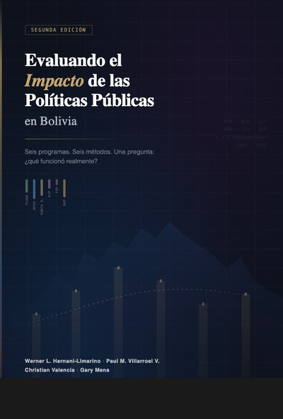
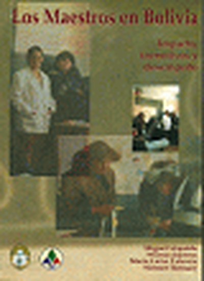

::: {.lang-switch}
[English](../books.qmd) · [Inicio](index.qmd) · [Investigación](investigacion.qmd) · [CV](cv.qmd) · [Código](codigo.qmd)
:::

::: {.section-rule}
Libros
:::

<!-- ── La distribución de la crisis ── -->
::: {.book-card}
::: {.book-cover}

:::
::: {.book-info}
::: {.book-title}
La distribución de la crisis
:::
::: {.book-subtitle}
Ganadores y perdedores del ajuste en Bolivia
:::
::: {.book-meta}
Borrador para comentarios · 2026
:::
::: {.book-summary}
En 2025 la pobreza moderada en Bolivia subió de 38,1% a 44,7% de la población, lo que sumó 808 mil personas pobres en un año, un aumento 3,5 veces mayor que el de la pandemia. *La distribución de la crisis* mide cómo se repartieron entre los hogares bolivianos los costos de la crisis de 2025 y del ajuste posterior: quiénes perdieron, quiénes ganaron, cuánto duran las pérdidas y qué instrumentos de política pueden reducirlas dentro de la trayectoria fiscal acordada con el FMI.

El libro mide la pandemia, la escasez de dólares, el decreto de combustibles de diciembre de 2025, la flotación cambiaria y la recesión de 2026 con una sola unidad, la pérdida de ingreso real de cada hogar frente a un periodo normal. Algo más de la mitad del aumento de la pobreza de 2025 se debe a que los alimentos se encarecieron más que el índice de precios al consumidor, y alrededor de un tercio a la caída del ingreso laboral real. Los nuevos pobres vivían sobre todo en las ciudades, en hogares de ingreso medio bajo cercanos a la línea de pobreza. Esos hogares recibieron menos rentas de los precios oficiales que los estratos altos y, en relación con su pérdida, menos compensación que los más pobres. Son quienes recibieron menos y pagaron más.

El libro proyecta una pobreza moderada de 46,3% en 2026 y plantea escenarios para 2027 y 2028 condicionados al programa con el FMI. Compara las transferencias de 2026 con una transferencia regular que llene la brecha de ingreso de los hogares más pobres, y muestra que recortar las prestaciones sociales es el instrumento fiscal que más aumenta la pobreza por cada punto del PIB ahorrado.
:::
::: {.book-links}
[Descargar libro](../files/la_distribucion_de_la_crisis.pdf){.book-link}
:::
:::
:::

---

<!-- ── Mi Otro Género ── -->
::: {.book-card}
::: {.book-cover}

:::
::: {.book-info}
::: {.book-title}
Mi Otro Género
:::
::: {.book-subtitle}
Hermanas, hermanos y la formación e imposición de las normas que los separan
:::
::: {.book-meta}
Con Alejandra Villegas Gutierrez · Desigualdad en Bolivia, vol. 1 · Primera edición · 2026
:::
::: {.book-summary}
En Bolivia, las hermanas jóvenes llegaron a estudiar más que sus hermanos, pero dentro de las familias en que ambos siguen viviendo ellas tienen empleo con menor frecuencia. En el censo de 2024 la diferencia es de 9,6 puntos. Era de 38 puntos en 1976 y de 9,4 en 2001, y después casi dejó de bajar, aunque siguieron expandiéndose la educación de las mujeres, el empleo de las madres y el reconocimiento legal de la igualdad.

*Mi otro género* pregunta por qué. Distingue dos razones: la formación, lo que una hija aprende a querer y a esperar, y la imposición, lo que otras personas o ciertas reglas deciden por ella. Pone a prueba cada una al comparar a hermanas y hermanos criados en el mismo hogar en los censos de Bolivia, Perú y México. La evidencia ubica una parte de la diferencia que queda en la asignación del tiempo y del cuidado dentro del hogar, un ámbito que ninguna reforma del periodo alcanzó y que las estadísticas bolivianas todavía no miden en horas.
:::
::: {.book-links}
[Página del libro](../mi-otro-genero/){.book-link .book-link-buy}
[Descargar libro](../mi-otro-genero/mi-otro-genero.pdf){.book-link}
[Leer una muestra](../mi-otro-genero/mi-otro-genero-muestra.pdf){.book-link}
:::
:::
:::

---

<!-- ── Medio siglo de movilidad social en Bolivia ── -->
::: {.book-card}
::: {.book-cover}

:::
::: {.book-info}
::: {.book-title}
Medio siglo de movilidad social en Bolivia
:::
::: {.book-subtitle}
Cinco censos, 1976–2024
:::
::: {.book-meta}
Desigualdad en Bolivia · Primera edición · 2026
:::
::: {.book-summary}
Entre 1976 y 2024 Bolivia pasó de ser un país en el que la mitad de los adultos nunca había asistido a la escuela a uno en el que casi todos los niños asisten a ella, y en el que siete u ocho de cada diez jóvenes estudian más que sus padres. *Medio siglo de movilidad social en Bolivia* pregunta si esos avances cambiaron el orden en que se ubican las familias, es decir, si el lugar que una persona ocupa entre sus contemporáneos depende hoy menos que antes del lugar que ocupaban sus padres. Con los cinco censos de población del período, las Encuestas de Hogares, las encuestas de opinión regionales y los registros públicos de ministros, legisladores y planillas, el libro mide la herencia comparando a cada persona con su propia generación, lo que permite separar la expansión de la escuela de la reducción de la herencia.

La respuesta tiene dos partes. En la escolaridad, la herencia se redujo en dos quintas partes, sobre todo por la convergencia entre el campo y la ciudad. Fuera de la escuela, en cambio, la ventaja de los hijos de padres con más escolaridad para concluir la universidad, ejercer las profesiones de mayor prestigio y llegar a una ocupación profesional con los mismos estudios es hoy mayor que hace cincuenta años, y el acceso al empleo público favorece a los hijos de quienes ya trabajan en él bajo gobiernos de distinto signo.

El libro examina además el legado de la hacienda, el mestizaje, las diferencias entre hijas e hijos, la migración y la educación inicial, y propone políticas para abrir la parte alta de la distribución y elevar su base, financiadas con impuestos a las herencias y a las grandes fortunas.
:::
::: {.book-links}
[Descargar libro](../files/medio_siglo_movilidad_social_bolivia.pdf){.book-link}
[Presentación (ES)](../files/medio_siglo_slides_ES.pdf){.book-link}
[Presentación (EN)](../files/medio_siglo_slides_EN.pdf){.book-link}
:::
:::
:::

---

<!-- ── Structural Economics ── -->
::: {.book-card}
::: {.book-cover}

:::
::: {.book-info}
::: {.book-title}
Structural Economics
:::
::: {.book-subtitle}
The General Case
:::
::: {.book-meta}
Manuscrito en borrador · 2027
:::
::: {.book-summary}
El modelo neoclásico descansa sobre un único supuesto: todos los agentes reciben igual peso en la agregación social, codificado como W = (1/N)**11**ʹ. *Structural Economics* reemplaza ese supuesto con una matriz de pesos arbitraria W — y muestra que todo el edificio neoclásico, desde los teoremas del bienestar hasta la teoría del crecimiento, es simplemente el caso especial donde W resulta ser uniforme. Este libro de texto es el caso general.

La matriz de pesos se deriva de tres redes subyacentes que coexisten en toda economía: una red de producción e intercambio que determina quién transacciona con quién, una red de poder y negociación que determina cuyas preferencias prevalecen en el conflicto, y una red de información que determina cuyas creencias se tratan como autorizadas. Juntas, estas redes producen el vector propio de Perron que gobierna los resultados distributivos — una cantidad que la teoría estándar suprime en lugar de explicar.

Organizado en siete partes, el libro cubre la reformulación matricial de la microeconomía y macroeconomía estándar, el modelo formal de formación endógena de preferencias (el cociente Ψ), la dinámica del cambio estructural, la medición mediante matrices de contabilidad social, y la economía política de la hegemonía y la contrahegemonía. El capítulo final, *El Caso General*, deriva las condiciones bajo las cuales el modelo neoclásico se sostiene — y documenta por qué casi nunca se cumplen.
:::
::: {.book-links}
[Descargar borrador](../files/structural_economics.pdf){.book-link}
[Manual de soluciones (en inglés)](../files/structural_economics_solutions_manual.pdf){.book-link}
:::
:::
:::

---

<!-- ── Hunger & Fire ── -->
::: {.book-card}
::: {.book-cover}

:::
::: {.book-info}
::: {.book-title}
Hunger & Fire
:::
::: {.book-subtitle}
Cómo las comidas de los oprimidos se convirtieron en los platos de los poderosos
:::
::: {.book-meta}
2025
:::
::: {.book-summary}
Todo economista conoce la mano invisible de Adam Smith. Este libro trata sobre la otra mitad: el puño invisible. Los alimentos más extraordinarios de la tierra fueron creados por las personas más oprimidas de la tierra. No como coincidencia. Como consecuencia. La restricción produce ingenio; la escasez produce creatividad. Las personas que recibieron los desechos — los huesos, las vísceras, los granos más baratos, las partes descartadas — transformaron esos desechos en cocinas de asombrosa profundidad y belleza. Y luego, con la predictibilidad de una ley física, los poderosos se apropiaron de esas cocinas.

*Hunger & Fire* sigue diez platos a través de diez capítulos, cada uno arraigado en un lugar específico, una historia específica y una comunidad específica cuyo genio culinario el mundo ha consumido sin pago ni crédito adecuados: soul food y rabo de buey en el sur de Estados Unidos, ramen y las ruinas del imperio en Japón, feijoada en Brasil, hummus y la guerra del garbanzo en el Levante, jollof rice en África Occidental, el curry y el aplanamiento colonial de un continente, phở en Vietnam, tacos y la muerte del maíz sagrado en México, injera y el teff en Etiopía, y el chuño — la papa deshidratada por congelación que alimentó las minas de plata de Potosí — en Bolivia.

Cada capítulo entreteje tres hilos: la economía política de cómo el poder moldeó la comida, la historia de los eventos específicos que produjeron la situación actual, y lo personal — comer y cocinar estos platos, frecuentemente con su hija Anahí, la crítica gastronómica más honesta que ha conocido.
:::
::: {.book-links}
[Leer muestra (Intro + Cap. 1)](../files/hunger_fire_sample.pdf){.book-link}
[Kindle](#){.book-link .book-link-buy}
[Paperback](#){.book-link .book-link-buy}
[Audible — próximamente]{.book-link .book-link-soon}
:::
:::
:::

---

<!-- ── Protocols of Power ── -->
::: {.book-card}
::: {.book-cover}

:::
::: {.book-info}
::: {.book-title}
Protocols of Power
:::
::: {.book-subtitle}
Stablecoins, soberanía y el nuevo orden monetario
:::
::: {.book-meta}
2025
:::
::: {.book-summary}
En Beirut, una madre usa un grupo de Telegram y una billetera Tron para pagar la matrícula universitaria de su hijo en París. Sin banco, sin código SWIFT, sin autorización gubernamental. Dos smartphones, una fe compartida en una stablecoin y una red blockchain que ningún ministerio de finanzas controla.

*Protocols of Power* es un diagnóstico del silencioso golpe de estado que está reformando las finanzas globales — no ejecutado en parlamentos, sino en repositorios de GitHub, conjuntos de validadores y pruebas de conocimiento cero. Las stablecoins están dolarizando el mundo más rápido de lo que el FMI jamás pudo. Tether corriendo sobre Tron se ha convertido en un SWIFT informal, mercado de divisas y sistema de depósito en garantía para miles de millones de personas excluidas de las redes bancarias del primer mundo. Los exchanges se han convertido en bancos centrales apátridas. Los protocolos están absorbiendo las funciones que antes desempeñaban los imperios y los estados.

El libro avanza a través de diez capítulos en cuatro partes: el colapso del orden de Bretton Woods y su reemplazo por una infraestructura en la sombra; los nuevos imperios (el yuan digital como estado de vigilancia, Binance como gobierno rival, USDC como finanzas institucionales en cadena); las nuevas armas monetarias (weaponización financiera del código, almacenamiento en frío como soberanía); y el desenlace — un dólar bifurcado y los contornos de un Bretton Woods II en la sombra. Cada capítulo abre con un Despacho desde el Frente: una escena ficcionalizada pero documentada desde Beirut, Lagos, San Francisco, Cantón, Estambul, Lima, La Habana, Accra y otros lugares. Los personajes son inventados; los sistemas que navegan son reales.
:::
::: {.book-links}
[Leer muestra (Prólogo + Cap. 1)](../files/protocols_of_power_sample.pdf){.book-link}
[Kindle](#){.book-link .book-link-buy}
[Paperback](#){.book-link .book-link-buy}
:::
:::
:::

---

<!-- ── Evaluando ── -->
::: {.book-card}
::: {.book-cover}

:::
::: {.book-info}
::: {.book-title}
Evaluando el Impacto de las Políticas Públicas en Bolivia
:::
::: {.book-subtitle}
Segunda Edición
:::
::: {.book-meta}
Con P.M. Villarroel, C. Valencia y G. Mena · Fundación ARU / IISEC–UCB · 2015
:::
::: {.book-summary}
Entre 2001 y 2015, Bolivia amplió drásticamente el gasto social — empleo de emergencia, pensiones universales, subsidios escolares, campañas de alfabetización, capacitación juvenil y microcrédito. El veredicto oficial sobre cada programa fue positivo. Este libro cuenta una historia diferente.

Seis programas, seis métodos, una pregunta: *¿qué funcionó realmente?* Usando PSM, Diferencias en Diferencias, Regresión Discontinua difusa, Cambios en Cambios, modelos estructurales de hogares y Series de Tiempo Interrumpidas, los autores encuentran resultados más complejos e incómodos de lo que admiten las narrativas oficiales. PLANE estabilizó el consumo durante la crisis pero no generó empleabilidad. MPED produjo un gran salto en el empleo formal — que desapareció en 18 meses. La Renta Dignidad incrementó el ingreso de los hogares pero redujo significativamente la oferta laboral femenina. El Bono Juancito Pinto solo movió la matrícula para niños de 6 a 8 años. Yo Sí Puedo certificó a 824.000 adultos como "alfabetizados" mientras las pruebas directas mostraron prácticamente ninguna ganancia en comprensión. El microcrédito del BDP produjo efectos fuertes en manufactura y ninguno en agricultura.

La lección transversal: la heterogeneidad es la regla, los efectos no deseados son comunes, y los impactos positivos tienden a ser transitorios. El argumento final del libro es institucional — Bolivia ya produce buena investigación; la restricción vinculante es la voluntad política de dejar que la evidencia importe.
:::
::: {.book-links}
[GitHub](https://github.com/wernerhl/evaluando-impacto-bolivia){.book-link target="_blank"}
:::
:::
:::

---

<!-- ── Los maestros ── -->
::: {.book-card}
::: {.book-cover}

:::
::: {.book-info}
::: {.book-title}
Los maestros en Bolivia: Impacto, incentivos y desempeño
:::
::: {.book-meta}
Con M. Urquiola, W. Jiménez y M.L. Talavera · Editorial Sierpe · 2000
:::
::: {.book-summary}
Bolivia había aumentado los salarios docentes, ampliado la formación de maestros e invertido fuertemente en reforma educativa — y sin embargo el rendimiento estudiantil se mantenía obstinadamente bajo. Este libro pregunta por qué y qué palancas de política funcionan realmente.

Apoyándose en las pruebas SIMECAL, encuestas de hogares, encuestas a docentes e investigación cualitativa, los autores encuentran que las credenciales observables de los maestros y los niveles salariales tienen escaso impacto en el rendimiento estudiantil una vez controlado el contexto socioeconómico del alumnado. La motivación y el desempeño en realidad *declinan* con la antigüedad — precisamente la variable que impulsa la remuneración bajo el escalafón boliviano. En contraste, los maestros en escuelas privadas y de Fe y Alegría — instituciones con incentivos de desempeño más sólidos y mayor rendición de cuentas — muestran sistemáticamente mayor dedicación y mejores resultados.

El libro reenmarca la pregunta de política: no "¿están bien pagados los maestros?" sino "¿cómo deben diseñarse el pago y los incentivos para atraer y motivar mejores maestros?". Evalúa los sistemas de incentivos propuestos para Bolivia — incluido el bono de permanencia rural y el esquema de incentivos colectivos — y provee recomendaciones de diseño concretas basadas en evidencia.
:::
::: {.book-links}
[Leer en línea](http://biblioteca.usfa.edu.bo/cgi-bin/koha/opac-detail.pl?biblionumber=5816){.book-link target="_blank"}
[Descargar PDF](https://www.aru.org.bo/REPEC/pdf/MaestrosBolivia.pdf){.book-link target="_blank"}
:::
:::
:::
