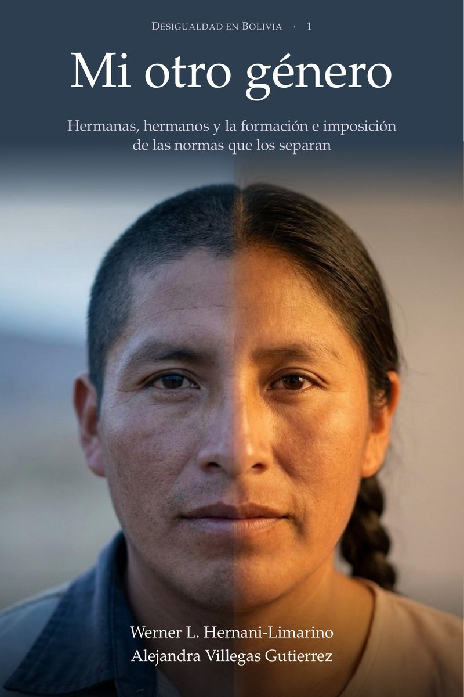

::: {.lang-switch}
[English](../mi-otro-genero.qmd) · [Libros](libros.qmd) · [Inicio](index.qmd) · [Investigación](investigacion.qmd) · [CV](cv.qmd)
:::

::: {.bk-hero}
::: {.bk-cover}
{width=100% fig-alt="Portada de Mi otro género"}
:::
::: {.bk-head}
::: {.bk-series}
Desigualdad en Bolivia · Volumen 1
:::
::: {.bk-title}
Mi otro género
:::
::: {.bk-subtitle}
Hermanas, hermanos y la formación e imposición de las normas que los separan
:::
::: {.bk-authors}
Werner L. Hernani-Limarino y Alejandra Villegas Gutierrez
:::
::: {.bk-meta}
Primera edición · 2026 · 296 páginas · Español · Descarga gratuita
:::
::: {.bk-lead}
En Bolivia, las hermanas jóvenes llegaron a estudiar más que sus hermanos, pero dentro de las familias en que ambos siguen viviendo ellas tienen empleo con menor frecuencia. En el censo de 2024 la diferencia es de 9,6 puntos. Era de 38 puntos en 1976 y de 9,4 en 2001, y después casi dejó de bajar. Este libro pregunta por qué, y distingue entre lo que una hija aprendió a querer y lo que otras personas deciden por ella.
:::
::: {.bk-buttons}
[Descargar el libro (PDF)](../files/mi_otro_genero.pdf){.book-link .book-link-buy}
[Leer una muestra](../files/mi_otro_genero_muestra.pdf){.book-link}
[Cómo citar](#como-citar){.book-link}
:::
:::
:::

## Sobre el libro {#sobre-el-libro}

En el censo boliviano de 2024 hay 157 620 hogares donde viven al menos una hija y un hijo de 17 a 30 años de la persona que encabeza el hogar. En esas familias, la hermana tiene empleo con una frecuencia 9,6 puntos menor que la de su hermano, según la definición de empleo de la 19.ª Conferencia Internacional de Estadísticos del Trabajo. La comparación equivale a unos diez hermanos más con empleo por cada cien hermanas y cien hermanos. Hace medio siglo la distancia era mucho mayor y bajó con rapidez hasta 2001. Desde entonces casi no se redujo, aunque siguieron expandiéndose la educación de las mujeres, el empleo de las madres y el reconocimiento legal de la igualdad.

El libro distingue dos razones para esa distancia. La primera es la **formación**: lo que una hija aprende a querer y a esperar a partir de lo que ve en su madre, en las mujeres de su comunidad y en las personas con las que crece. La segunda es la **imposición**: lo que otras personas o ciertas reglas deciden por ella, como la asignación del cuidado, la restricción, la sanción y las reglas por defecto. Para ponerlas a prueba, compara a hermanas y hermanos criados en el mismo hogar, con los censos de Bolivia (1976 a 2024), Perú (1993 a 2017) y México (2020) y con las encuestas de hogares, y examina la casa, la vida en pareja, la escuela, el mercado de trabajo, la violencia y los concejos municipales.

## Lo que encuentra {#lo-que-encuentra}

::: {.bk-findings}
1. **La diferencia bajó hasta 2001 junto con el empleo de las mujeres de la generación de la madre.** Ese patrón es compatible con una formación que se transmite de una generación a otra y con restricciones que se relajaban.
2. **Después de 2001 esas condiciones siguieron extendiéndose, pero distinguen cada vez menos a los hogares donde la diferencia es pequeña.** Lo mismo ocurre con el empleo de las madres, el de las mujeres de la comunidad y la educación superior de las hijas.
3. **Las hermanas dejaron en buena parte las labores de la casa como actividad principal.** Estudian más que sus hermanos y buscan empleo con la misma frecuencia que ellos, sin llegar a tenerlo con esa misma frecuencia.
4. **Una parte de la diferencia que queda se ubica en la asignación del tiempo y del cuidado dentro del hogar.** En una minoría de hogares, el cuidado del niño pequeño pasa a una hermana cuando la madre sale a trabajar. Los datos no permiten atribuir la diferencia a un solo mecanismo.
5. **Las reformas del periodo alcanzaron el Estado, la escuela, la ley penal y la ley de familia.** Ninguna actuó sobre la asignación del cuidado dentro del hogar, un ámbito que Bolivia todavía no mide en horas ni en restricciones.
:::

::: {.bk-stats}
::: {.bk-stat}
::: {.bk-stat-n}
9,6
:::
::: {.bk-stat-l}
puntos de diferencia de empleo entre hermana y hermano, Bolivia 2024
:::
:::
::: {.bk-stat}
::: {.bk-stat-n}
38 → 9,4
:::
::: {.bk-stat-l}
puntos entre 1976 y 2001, y 8,2 en 2024 con el mismo criterio
:::
:::
::: {.bk-stat}
::: {.bk-stat-n}
157 620
:::
::: {.bk-stat-l}
hogares con una hija y un hijo de 17 a 30 años en el censo de 2024
:::
:::
::: {.bk-stat}
::: {.bk-stat-n}
9
:::
::: {.bk-stat-l}
censos de tres países: Bolivia, Perú y México
:::
:::
:::

## Del prefacio {#prefacio}

::: {.bk-quote}
La posibilidad de disponer del propio tiempo tiene una historia social. Para estudiar, aceptar un empleo, participar en la vida pública o construir un proyecto personal, necesitamos que alguien realice el trabajo cotidiano que sostiene nuestra existencia. La distribución de ese trabajo organiza las oportunidades de cada integrante de una familia. También establece quién puede contar con la disponibilidad de los demás y quién aprende a organizar su vida alrededor de sus necesidades. En esa relación entre el tiempo propio y las obligaciones hacia otras personas comienza una parte fundamental de la desigualdad de género.

Este libro parte de una pregunta sobre la persistencia de ese orden en medio de cambios profundos. En Bolivia, las mujeres ampliaron su escolaridad, conquistaron derechos y alcanzaron una presencia importante en las instituciones políticas. Entre las generaciones jóvenes, las hermanas llegaron a acumular más años de estudio que sus hermanos. La diferencia en el acceso al empleo dentro de una misma familia siguió una trayectoria propia. Después de una reducción considerable durante las últimas décadas del siglo pasado, su disminución perdió impulso en las primeras décadas de este siglo. […]

La comparación entre hermanas y hermanos permite aproximarse a esa pregunta desde un lugar especialmente revelador. Dos personas pueden compartir vivienda, recursos familiares y una parte considerable de su entorno, y crecer sujetas a expectativas diferentes sobre lo que deben hacer con sus vidas. A una se le puede pedir que permanezca disponible para cuidar. De la otra se puede esperar que busque ingresos fuera de casa.
:::

[Leer el prefacio completo y el primer capítulo](../files/mi_otro_genero_muestra.pdf){.book-link}

## Dos razones: formación e imposición {#dos-razones}

::: {.bk-two}
::: {.bk-two-card}
### Formación
Los aprendizajes mediante los cuales ciertas actividades, aspiraciones y maneras de vivir llegan a parecer apropiadas para una mujer o para un hombre. La experiencia de una madre, las trayectorias de otras mujeres de la comunidad y las posibilidades visibles en el entorno pueden influir en lo que una hija considera deseable y alcanzable.
:::
::: {.bk-two-card}
### Imposición
Los mecanismos que sostienen el cumplimiento de esas expectativas: la asignación de obligaciones domésticas, las restricciones a la movilidad, el control de los recursos y las sanciones por apartarse de la conducta esperada. Su eficacia depende de quién puede exigir y de quién tiene capacidad para resistirse.
:::
:::

Los dos procesos se alimentan mutuamente. Las restricciones de una generación delimitan las experiencias que la siguiente tiene a su alcance, y las experiencias nuevas pueden modificar lo que se considera posible y legítimo. El libro formula preguntas sobre cada mecanismo y deja su peso a la investigación empírica.

## Contenido {#contenido}

::: {.bk-toc}
<details>
<summary>**Parte I.** La pregunta y cómo responderla</summary>

1. La pregunta
2. Normas, cuidado y poder en la vida familiar
3. Cómo comparamos
</details>

<details>
<summary>**Parte II.** Dentro de la casa</summary>

4. Hermanas y hermanos
5. La madre y el reparto del cuidado
6. Comunidades, pueblos y países
7. Después de la unión
</details>

<details>
<summary>**Parte III.** Fuera de la casa: lo que las reformas alcanzaron</summary>

8. La escuela
9. El mercado
10. La sanción y la restricción
11. Escaños y presupuesto municipal
</details>

<details>
<summary>**Parte IV.** Lo que cuesta, lo que responde el libro y lo que se puede hacer</summary>

12. Lo que cuesta y quién lo recibe
13. Lo que responde el libro
14. Decisiones de política
</details>

<details>
<summary>**Epílogo y apéndices**</summary>

- Epílogo. Tres generaciones y su otro género
- A. El modelo
- B. Datos, registro de resultados y reproducibilidad
- C. Estimaciones
- Glosario, bibliografía e índice analítico
</details>
:::

**Si tienes poco tiempo.** El capítulo 1 plantea la pregunta, el capítulo 13 da la respuesta, el capítulo 14 discute las decisiones de política y el epílogo cuenta tres generaciones de una familia boliviana con las cifras del libro.

## Datos y reproducibilidad {#datos}

El libro usa el Censo de Población y Vivienda 2024 de Bolivia (INE) y el de México de 2020, cuestionario ampliado (INEGI); los censos de Bolivia de 1976, 1992, 2001 y 2012 y de Perú de 1993, 2007 y 2017, en las muestras del 10 por ciento de IPUMS Internacional (Universidad de Minnesota); la Encuesta de Hogares y la Encuesta de Demografía y Salud de Bolivia; la ENIGH y la ENDIREH de México; las encuestas de hogares armonizadas de SEDLAC; los presupuestos municipales ejecutados y los resultados electorales de Bolivia. Salvo las cifras publicadas por otras instituciones, todos los cálculos son de los autores. El apéndice B describe las fuentes, el registro de resultados, los programas y las decisiones de codificación.

## Cómo citar {#como-citar}

::: {.bk-cite}
Hernani-Limarino, W. L. y Villegas Gutierrez, A. (2026). *Mi otro género: hermanas, hermanos y la formación e imposición de las normas que los separan*. Primera edición. Desigualdad en Bolivia, volumen 1. https://wernerhl.github.io/mi-otro-genero.html
:::

<details class="bk-bib">
<summary>BibTeX</summary>

```
@book{HernaniVillegas2026MiOtroGenero,
  author    = {Hernani-Limarino, Werner L. and Villegas Gutierrez, Alejandra},
  title     = {Mi otro género: hermanas, hermanos y la formación e imposición de las normas que los separan},
  year      = {2026},
  edition   = {Primera},
  series    = {Desigualdad en Bolivia},
  number    = {1},
  language  = {spanish},
  url       = {https://wernerhl.github.io/mi-otro-genero.html}
}
```
</details>

## Los autores {#autores}

**Werner L. Hernani-Limarino** es economista del desarrollo y trabaja en AI Analytics y en la Academia Boliviana de Ciencias Económicas. Su investigación abarca la medición de la pobreza, el análisis distribucional y la movilidad intergeneracional en Bolivia y América Latina. [Perfil y publicaciones](cv.qmd)

**Alejandra Villegas Gutierrez** es coautora del libro y de varios de los documentos de trabajo en que se basa.

## La serie Desigualdad en Bolivia {#serie}

Desigualdad en Bolivia reúne libros que estudian quién obtiene qué en Bolivia y por qué esas diferencias persisten, con los censos de 1976 a 2024 y las encuestas de hogares. Cada volumen examina una forma de desigualdad:

- la que separa a hermanas y hermanos criados en la misma casa, en *Mi otro género* (volumen 1, este libro);
- la que se transmite de padres a hijos dentro de cada comunidad, en [*El paisaje roto*](libros.qmd);
- la que dejó el reparto de las pérdidas y ganancias de la crisis y del ajuste de 2019 a 2026, en *La distribución de la crisis*.

## Contacto {#contacto}

Comentarios, correcciones y solicitudes de entrevistas o presentaciones: [wernerhl@gmail.com](mailto:wernerhl@gmail.com). Los documentos de trabajo en que se basa el libro están en la página de [investigación](investigacion.qmd).

```{=html}
<script type="application/ld+json">
{
  "@context": "https://schema.org",
  "@type": "Book",
  "name": "Mi otro género",
  "alternativeHeadline": "Hermanas, hermanos y la formación e imposición de las normas que los separan",
  "inLanguage": "es",
  "datePublished": "2026",
  "bookEdition": "Primera edición",
  "numberOfPages": 296,
  "url": "https://wernerhl.github.io/es/mi-otro-genero.html",
  "image": "https://wernerhl.github.io/images/covers/mi_otro_genero_800.jpg",
  "description": "Libro sobre la diferencia de empleo entre hermanas y hermanos criados en la misma casa en Bolivia, Perú y México, y sobre cómo la formación y la imposición de las normas de género la sostienen.",
  "keywords": "normas de género, empleo femenino, hermanas y hermanos, formación e imposición, cuidado, censos, Bolivia, América Latina",
  "author": [
    {"@type": "Person", "name": "Werner L. Hernani-Limarino", "url": "https://wernerhl.github.io"},
    {"@type": "Person", "name": "Alejandra Villegas Gutierrez"}
  ],
  "isPartOf": {"@type": "BookSeries", "name": "Desigualdad en Bolivia", "position": 1},
  "isAccessibleForFree": true,
  "workExample": {
    "@type": "Book",
    "bookFormat": "https://schema.org/EBook",
    "encodingFormat": "application/pdf",
    "url": "https://wernerhl.github.io/files/mi_otro_genero.pdf"
  }
}
</script>
```
