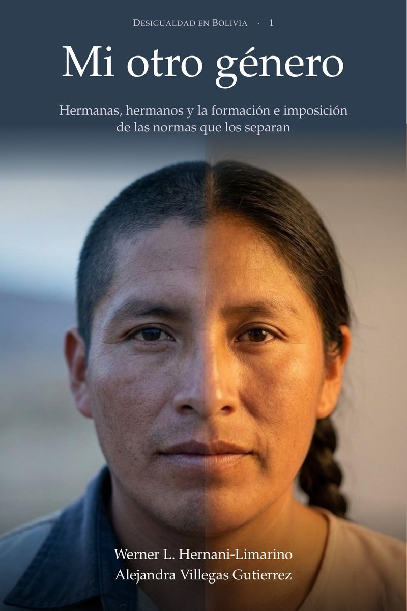

::: {.lang-switch}
[Español](es/mi-otro-genero.qmd) · [Books](books.qmd) · [Home](index.qmd) · [Research](research.qmd) · [CV](cv.qmd)
:::

::: {.bk-hero}
::: {.bk-cover}
{width=100% fig-alt="Cover of Mi otro género"}
:::
::: {.bk-head}
::: {.bk-series}
Desigualdad en Bolivia · Volume 1
:::
::: {.bk-title}
Mi otro género
:::
::: {.bk-subtitle}
Hermanas, hermanos y la formación e imposición de las normas que los separan
:::
::: {.bk-authors}
Werner L. Hernani-Limarino and Alejandra Villegas Gutierrez
:::
::: {.bk-meta}
First edition · 2026 · 296 pages · In Spanish · Free download
:::
::: {.bk-lead}
Sisters, brothers, and the formation and imposition of the norms that separate them. In Bolivia, young women now study more than their brothers, yet within families where both still live they are employed less often. In the 2024 census the gap is 9.6 percentage points. It was 38 points in 1976 and 9.4 in 2001, and it has barely fallen since. This book asks why, and separates what a daughter has learned to want from what other people decide for her.
:::
::: {.bk-buttons}
[Download the book (PDF)](files/mi_otro_genero.pdf){.book-link .book-link-buy}
[Read a sample](files/mi_otro_genero_muestra.pdf){.book-link}
[How to cite](#how-to-cite){.book-link}
:::
:::
:::

## About the book {#about}

The 2024 Bolivian census contains 157,620 households with at least one daughter and one son aged 17 to 30 of the household head. In those families the sister is employed less often than her brother, by 9.6 percentage points under the definition of the 19th International Conference of Labour Statisticians. That is about ten more employed brothers than sisters for every hundred of each. Half a century ago the gap was much larger and it fell quickly until 2001. Since then it has hardly changed, even though women's schooling, mothers' employment and the legal recognition of equality kept expanding.

The book separates two reasons for the gap. **Formation** is what a daughter learns to want and expect from what she sees in her mother, in the women of her community and in the people she grows up with. **Imposition** is what other people or rules decide for her: the assignment of care, restriction, sanction and default rules. To test them, the book compares sisters and brothers raised in the same household, using the censuses of Bolivia (1976 to 2024), Peru (1993 to 2017) and Mexico (2020) and household surveys. It examines the home, life as a couple, school, the labour market, violence and municipal councils. The book is written in Spanish.

## What it finds {#findings}

::: {.bk-findings}
1. **The gap fell until 2001 along with the employment of women of the mother's generation.** The pattern is compatible with formation passed from one generation to the next and with restrictions that were relaxing.
2. **After 2001 those conditions kept spreading, but they distinguish households with a small gap less and less.** This holds for mothers' employment, for the employment of women in the community and for daughters' higher education.
3. **Sisters largely stopped reporting housework as their main activity.** They study more than their brothers and look for work as often as they do, without reaching employment as often.
4. **Part of the remaining gap lies in how time and care are assigned inside the home.** In a minority of households, the care of a young child passes to a sister when the mother goes to work. The data do not allow attributing the gap to a single mechanism.
5. **The reforms of the period reached the state, the school, criminal law and family law.** None acted on the assignment of care within the household, an area that Bolivia does not yet measure in hours or in restrictions.
:::

::: {.bk-stats}
::: {.bk-stat}
::: {.bk-stat-n}
9.6
:::
::: {.bk-stat-l}
percentage points: employment gap between sister and brother, Bolivia 2024
:::
:::
::: {.bk-stat}
::: {.bk-stat-n}
38 → 9.4
:::
::: {.bk-stat-l}
points between 1976 and 2001; 8.2 in 2024 on the same definition
:::
:::
::: {.bk-stat}
::: {.bk-stat-n}
157,620
:::
::: {.bk-stat-l}
households with a daughter and a son aged 17 to 30, 2024 census
:::
:::
::: {.bk-stat}
::: {.bk-stat-n}
9
:::
::: {.bk-stat-l}
censuses from three countries: Bolivia, Peru and Mexico
:::
:::
:::

## From the preface (in Spanish) {#preface}

::: {.bk-quote}
La posibilidad de disponer del propio tiempo tiene una historia social. Para estudiar, aceptar un empleo, participar en la vida pública o construir un proyecto personal, necesitamos que alguien realice el trabajo cotidiano que sostiene nuestra existencia. La distribución de ese trabajo organiza las oportunidades de cada integrante de una familia. También establece quién puede contar con la disponibilidad de los demás y quién aprende a organizar su vida alrededor de sus necesidades. En esa relación entre el tiempo propio y las obligaciones hacia otras personas comienza una parte fundamental de la desigualdad de género.

Este libro parte de una pregunta sobre la persistencia de ese orden en medio de cambios profundos. En Bolivia, las mujeres ampliaron su escolaridad, conquistaron derechos y alcanzaron una presencia importante en las instituciones políticas. Entre las generaciones jóvenes, las hermanas llegaron a acumular más años de estudio que sus hermanos. La diferencia en el acceso al empleo dentro de una misma familia siguió una trayectoria propia. Después de una reducción considerable durante las últimas décadas del siglo pasado, su disminución perdió impulso en las primeras décadas de este siglo. […]

La comparación entre hermanas y hermanos permite aproximarse a esa pregunta desde un lugar especialmente revelador. Dos personas pueden compartir vivienda, recursos familiares y una parte considerable de su entorno, y crecer sujetas a expectativas diferentes sobre lo que deben hacer con sus vidas. A una se le puede pedir que permanezca disponible para cuidar. De la otra se puede esperar que busque ingresos fuera de casa.
:::

*In short: the time a person can call their own depends on who does the daily work that sustains everyone else, and that work is distributed unevenly within families. The book asks why, in a country where women have gained schooling, rights and political presence, the employment gap between a sister and a brother stopped closing.*

[Read the full preface and the first chapter](files/mi_otro_genero_muestra.pdf){.book-link}

## Two reasons: formation and imposition {#two-reasons}

::: {.bk-two}
::: {.bk-two-card}
### Formation
The learning through which certain activities, aspirations and ways of living come to seem appropriate for a woman or for a man. A mother's experience, the paths of other women in the community and the possibilities visible in the surroundings can shape what a daughter finds desirable and attainable.
:::
::: {.bk-two-card}
### Imposition
The mechanisms that sustain compliance with those expectations: the assignment of domestic duties, restrictions on mobility, control of resources and sanctions for departing from expected conduct. Their force depends on who can demand and who is able to resist.
:::
:::

The two processes feed each other. The restrictions of one generation set the experiences within reach of the next, and new experiences can change what is considered possible and legitimate. The book poses questions about each mechanism and leaves their weight to empirical work.

## Contents {#contents}

Chapter titles are translated here; the book is in Spanish.

::: {.bk-toc}
<details>
<summary>**Part I.** The question and how to answer it</summary>

1. The question
2. Norms, care and power in family life
3. How we compare
</details>

<details>
<summary>**Part II.** Inside the home</summary>

4. Sisters and brothers
5. The mother and the sharing of care
6. Communities, peoples and countries
7. After the union
</details>

<details>
<summary>**Part III.** Outside the home: what the reforms reached</summary>

8. School
9. The labour market
10. Sanction and restriction
11. Seats and the municipal budget
</details>

<details>
<summary>**Part IV.** What it costs, what the book answers and what can be done</summary>

12. What it costs and who receives it
13. What the book answers
14. Policy decisions
</details>

<details>
<summary>**Epilogue and appendices**</summary>

- Epilogue. Three generations and their other gender
- A. The model
- B. Data, results registry and reproducibility
- C. Estimates
- Glossary, bibliography and subject index
</details>
:::

**If you are short of time.** Chapter 1 poses the question, chapter 13 gives the answer, chapter 14 discusses policy decisions, and the epilogue follows three generations of a Bolivian family using the book's figures.

## Data and reproducibility {#data}

The book uses Bolivia's 2024 Population and Housing Census (INE) and Mexico's 2020 census, extended questionnaire (INEGI); the Bolivian censuses of 1976, 1992, 2001 and 2012 and the Peruvian censuses of 1993, 2007 and 2017, in the 10 per cent samples of IPUMS International (University of Minnesota); the Bolivian Household Survey and Demographic and Health Survey; Mexico's ENIGH and ENDIREH; the harmonised household surveys of SEDLAC; executed municipal budgets and electoral results from Bolivia. Except for figures published by other institutions, all calculations are the authors' own. Appendix B describes the sources, the registry of results, the programs and the coding decisions.

## How to cite {#how-to-cite}

::: {.bk-cite}
Hernani-Limarino, W. L., and Villegas Gutierrez, A. (2026). *Mi otro género: hermanas, hermanos y la formación e imposición de las normas que los separan*. First edition. Desigualdad en Bolivia, volume 1. https://wernerhl.github.io/mi-otro-genero.html
:::

<details class="bk-bib">
<summary>BibTeX</summary>

```
@book{HernaniVillegas2026MiOtroGenero,
  author    = {Hernani-Limarino, Werner L. and Villegas Gutierrez, Alejandra},
  title     = {Mi otro género: hermanas, hermanos y la formación e imposición de las normas que los separan},
  year      = {2026},
  edition   = {Primera},
  series    = {Desigualdad en Bolivia},
  number    = {1},
  language  = {spanish},
  url       = {https://wernerhl.github.io/mi-otro-genero.html}
}
```
</details>

## The authors {#authors}

**Werner L. Hernani-Limarino** is a development economist at AI Analytics and the Bolivian Academy of Economic Sciences. His research covers poverty measurement, distributional analysis and intergenerational mobility in Bolivia and Latin America. [Profile and publications](cv.qmd)

**Alejandra Villegas Gutierrez** is a co-author of the book and of several of the working papers on which it is based.

## The series Desigualdad en Bolivia {#series}

Desigualdad en Bolivia brings together books on who gets what in Bolivia and why those differences persist, using the censuses from 1976 to 2024 and household surveys. Each volume examines one form of inequality:

- the one that separates sisters and brothers raised in the same home, in *Mi otro género* (volume 1, this book);
- the one passed from parents to children within each community, in [*El paisaje roto*](books.qmd);
- the one left by the distribution of the losses and gains of the crisis and the adjustment of 2019 to 2026, in *La distribución de la crisis*.

## Contact {#contact}

Comments, corrections, and requests for interviews or talks: [wernerhl@gmail.com](mailto:wernerhl@gmail.com). The working papers behind the book are on the [research](research.qmd) page.

```{=html}
<script type="application/ld+json">
{
  "@context": "https://schema.org",
  "@type": "Book",
  "name": "Mi otro género",
  "alternativeHeadline": "Hermanas, hermanos y la formación e imposición de las normas que los separan",
  "inLanguage": "es",
  "datePublished": "2026",
  "bookEdition": "Primera edición",
  "numberOfPages": 296,
  "url": "https://wernerhl.github.io/mi-otro-genero.html",
  "image": "https://wernerhl.github.io/images/covers/mi_otro_genero_800.jpg",
  "description": "A book on the employment gap between sisters and brothers raised in the same home in Bolivia, Peru and Mexico, and on how the formation and imposition of gender norms sustain it.",
  "keywords": "gender norms, female employment, sisters and brothers, formation and imposition, care, censuses, Bolivia, Latin America",
  "author": [
    {"@type": "Person", "name": "Werner L. Hernani-Limarino", "url": "https://wernerhl.github.io"},
    {"@type": "Person", "name": "Alejandra Villegas Gutierrez"}
  ],
  "isPartOf": {"@type": "BookSeries", "name": "Desigualdad en Bolivia", "position": 1},
  "isAccessibleForFree": true,
  "workExample": {
    "@type": "Book",
    "bookFormat": "https://schema.org/EBook",
    "encodingFormat": "application/pdf",
    "url": "https://wernerhl.github.io/files/mi_otro_genero.pdf"
  }
}
</script>
```
